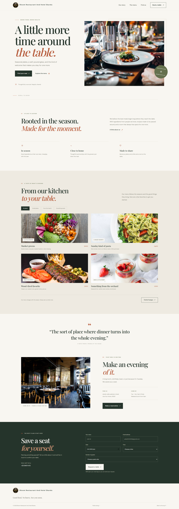

<div align="center">
  <h1>Baltora Hotel and Restaurant</h1>
  <p><strong>A thoughtful, responsive restaurant website for gathering around the table.</strong></p>
  <p>
    <a href="https://baltora-hotel-and-restaurant.vercel.app/">Visit the live site</a>
    &nbsp;·&nbsp;
    <a href="#getting-started">Run it locally</a>
    &nbsp;·&nbsp;
    <a href="#before-going-live">Launch checklist</a>
  </p>
</div>

<p align="center">
  
</p>

## About

Baltora Hotel and Restaurant's website is a single-page restaurant experience inspired by seasonal food, warm hospitality, and unhurried meals. Visitors can explore the restaurant story, browse a sample menu, find visit information, and prepare a table request.

The visual design pairs a warm paper palette with olive and rust accents, expressive serif headings, generous spacing, and food photography.

## Highlights

- **A welcoming landing page** with a prominent hero, clear calls to action, and restaurant story.
- **Interactive menu filters** for all plates, small plates, mains, and desserts.
- **Visit and reservation sections** with a guest-friendly table request form.
- **Responsive navigation and layouts** for desktop and smaller screens.
- **Accessible interface details**, including labeled form fields and navigation controls.
- **Search and sharing metadata**, including a canonical URL, description, Open Graph and Twitter cards, and Schema.org JSON-LD.
- **Crawl support** with `robots.txt` and an XML sitemap.

## Built with

- HTML5
- CSS3
- Vanilla JavaScript

There is no build step or package installation required.

## Getting started

Open `index.html` in a browser, or serve the project locally for a more realistic preview:

```powershell
py -m http.server 8000
```

Then visit [http://localhost:8000](http://localhost:8000).

## Project layout

```text
.
├── index.html
├── style.css
├── script.js
├── robots.txt
├── sitemap.xml
└── img/
    ├── Baltora Luxury Mountain Resort Emblem.png
    └── screencapture-bloom-restruant-and-hotel-vercel-app-2026-11-15-06_15_06.png
```

## How it works

- `index.html` contains the page content, reservation form, SEO metadata, and structured data.
- `style.css` provides the visual design, responsive layouts, and reduced-motion handling.
- `script.js` controls the mobile menu, menu filters, date minimum, and reservation email draft.
- `robots.txt` allows search crawlers and points them to the sitemap.
- `sitemap.xml` lists the site's canonical homepage.
- `img/` contains the brand emblem and this README's full-page preview.

The reservation form opens the visitor's default email application with a prefilled request; it does not submit to a booking service or confirm reservations automatically.

## Search visibility

The page includes a title and description, a canonical URL, social preview metadata, and JSON-LD entities for the website, web page, and restaurant. The sitemap and crawler instructions are configured for the current Vercel address:

`https://baltora-hotel-and-restaurant.vercel.app/`

After deploying, submit `https://baltora-hotel-and-restaurant.vercel.app/sitemap.xml` in Google Search Console. If the site moves to a custom domain, update the canonical and structured-data URLs in `index.html`, and the URLs in `robots.txt` and `sitemap.xml`.

## Before going live

Some page content is illustrative. Before using the site as the restaurant's official website:

1. Replace the sample menu, photography, address, opening hours, and contact details with verified business information.
2. Update the reservation email recipient in `script.js`.
3. Keep the Schema.org address and contact information consistent with what visitors can see on the page.
4. Confirm the canonical URL, social image, sitemap, and Google Search Console verification for the final domain.

## License

No license is currently specified for this project.
